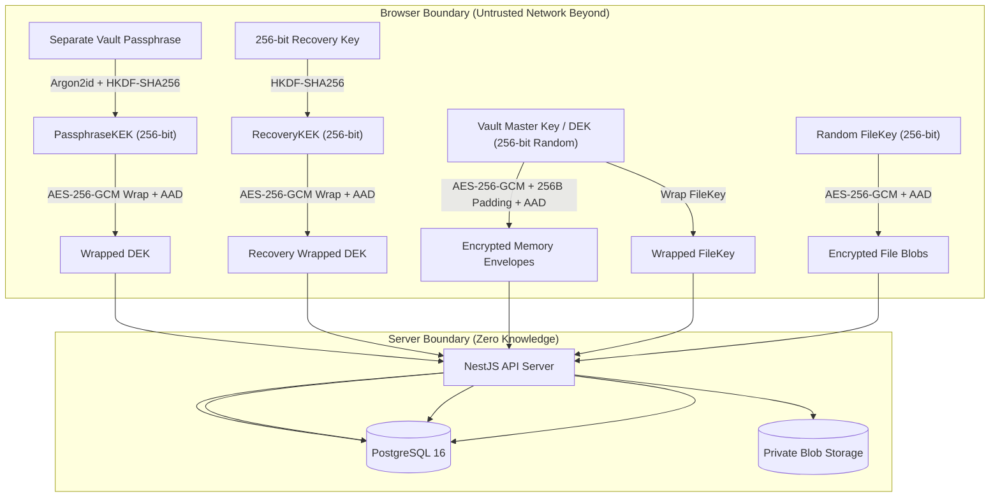

# Memoir

> **Your memories. Your keys. Your privacy.**  
> _A privacy-first, end-to-end encrypted personal diary platform built on zero-knowledge architecture and editorial craftsmanship._

---

## 1. Product Vision & The Zero-Knowledge Invariant

Memoir is an intentional, distraction-free personal journaling space engineered to protect your inner world. In an era of pervasive telemetry and server-side data harvesting, Memoir guarantees privacy through mathematics and software architecture rather than corporate terms of service.

### The Zero-Knowledge Invariant

> Even in the catastrophic scenario where the PostgreSQL database, Redis store, object storage, and server log files are completely exfiltrated by an adversary, the attacker **cannot** read any user's diary titles, Markdown bodies, private tags, moods, attachment filenames, or uploaded documents.

The backend API server operates exclusively over opaque ciphertext envelopes, blind to plaintext user thoughts.

---

## 2. Cryptographic Architecture

Memoir uses a three-secret separation model that strictly isolates account authentication credentials from encryption keys:



### Key Management Highlights:

- **Argon2id Memory-Hard KDF:** 64 MiB memory, 3 iterations, 1 lane running client-side via WebAssembly (`hash-wasm`).
- **Cryptographic Domain Separation:** HKDF-SHA256 ensures derived keys cannot collide across scopes (`memoir:kek:v1`, `memoir:recovery-kek:v1`).
- **Associated Authenticated Data (AAD):** Every ciphertext is cryptographically bound to `userId` and `recordId`, preventing record-swapping attacks.
- **Deterministic 256-Byte Block Padding:** Memory payloads are padded to prevent ciphertext-length side-channel inferences.
- **Zero-Reencryption Rotation:** Rotating the Vault Passphrase only derives a new `PassphraseKEK` and re-wraps the `DEK`. Zero diary entries require re-encryption.

---

## 3. Technology Stack

| Layer                   | Technologies                                                                                                |
| :---------------------- | :---------------------------------------------------------------------------------------------------------- |
| **Monorepo & Language** | TypeScript 5.7+ (`strict: true`), pnpm Workspaces                                                           |
| **Frontend**            | React 19, Vite, Tailwind CSS v4, Zustand, TanStack Query, Radix UI                                          |
| **Typography**          | Self-hosted `@fontsource/newsreader` (Serif), `@fontsource/plus-jakarta-sans`, `@fontsource/jetbrains-mono` |
| **Client Cryptography** | Native Web Crypto API (`AES-256-GCM`, `HKDF-SHA256`, CSPRNG), `hash-wasm` (Argon2id)                        |
| **Backend API**         | NestJS, Prisma ORM, OpenAPI / Swagger                                                                       |
| **Persistence & Cache** | PostgreSQL 16, Redis 7                                                                                      |
| **Mail & Edge**         | Mailpit (local SMTP), Docker Compose v2, Nginx / Caddy                                                      |

---

## 4. Local Development Setup

### 4.1 Prerequisites

Ensure the following tools are available in your path:

- Node.js `22.x LTS`
- `pnpm` (`10.x` or `9.x`)
- Docker & Docker Compose v2

### 4.2 Quickstart Sequence

```bash
# 1. Clone repository and install dependencies
pnpm install

# 2. Copy environment templates
cp .env.example .env
cp apps/api/.env.example apps/api/.env
cp apps/web/.env.example apps/web/.env

# 3. Start local database, cache, and mailer
docker compose up -d

# 4. Run Prisma database migrations
pnpm --filter api exec prisma migrate dev

# 5. Start development servers
pnpm dev
```

The services will be reachable at:

- **Web Application:** `http://localhost:5173`
- **Backend API:** `http://localhost:4000/api/v1`
- **OpenAPI / Swagger:** `http://localhost:4000/docs`
- **Mailpit Web UI:** `http://localhost:8025`

---

## 5. Quality & Verification Commands

```bash
# Verify code formatting
pnpm format:check

# Run ESLint across monorepo
pnpm lint

# Strict typechecking without emitting JS
pnpm typecheck

# Execute unit and cryptographic invariant tests
pnpm test

# Execute automated security regression suite
pnpm test:security

# Build production artifacts
pnpm build
```

---

## 6. Honest Threat Model & Security Boundaries

We believe transparent security engineering requires candid disclosure of residual risks:

- **Browser Trust Model:** In web-based E2EE, if an attacker compromises the web server and serves malicious JavaScript, client-side protections can be subverted. Mitigations include strict Content Security Policy (CSP), Subresource Integrity, automated secret scanning, and reproducible builds.
- **Endpoint Security:** Malware, hardware keyloggers, or rogue browser extensions on the client machine can observe unencrypted inputs or scrape RAM.
- **Metadata Visibility:** While title, content, tags, and moods are fully encrypted, the server observes the coarse entry date (`entryDate`), account status, creation timestamps, and padded ciphertext sizes.

For the comprehensive STRIDE analysis, see [`docs/THREAT_MODEL.md`](./docs/THREAT_MODEL.md).

---

## 7. Documentation Index

- [Implementation Plan & Roadmap](./docs/IMPLEMENTATION_PLAN.md)
- [System Requirements & Stack](./docs/REQUIREMENTS.md)
- [Development Setup Guide](./docs/DEVELOPMENT_SETUP.md)
- [Architecture & Boundaries](./docs/ARCHITECTURE.md)
- [Zero-Knowledge Cryptography Specification](./docs/CRYPTOGRAPHY.md)
- [STRIDE Threat Model & Security Policy](./docs/THREAT_MODEL.md)
- [Privacy Policy & Data Classification](./docs/PRIVACY.md)
- [REST API Specification](./docs/API.md)
- [Testing & Quality Assurance Guide](./docs/TESTING.md)
- [Production Deployment & Operations](./docs/DEPLOYMENT.md)
- [Unified Engineering & Security Report](./PROJECT_AND_SECURITY_REPORT.md)
- [Contributing Guidelines](./CONTRIBUTING.md)
- [Security Vulnerability Reporting](./SECURITY.md)
