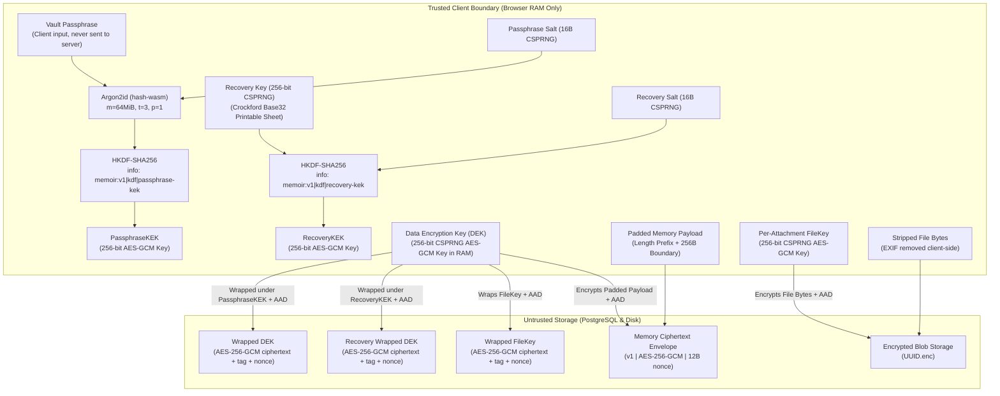

# Memoir Cryptographic Specification (v1)

> **Document Classification:** Engineering Cryptographic Reference  
> **Target Package:** `packages/crypto`  
> **Status:** Canonical Specification  

---

## 1. Core Principles & Zero-Knowledge Invariant

The Memoir platform is engineered around the **Zero-Knowledge Invariant**:

$$\forall \text{ record } R \in \text{MemoirStorage}, \quad \text{Plaintext}(R) \cap \text{ServerMemory} = \emptyset$$

Under no circumstances may plaintext memory content, titles, private tags, moods, filenames, or raw file bytes be transmitted to the server or stored in PostgreSQL, Redis, or object storage.

---

## 2. Three-Secret Separation & Key Hierarchy

Memoir strictly separates three distinct secret credentials:

1. **Account Authentication Password:** Sent over TLS to authenticate server sessions. Hashed server-side with Argon2id ($m=64\text{ MiB}, t=3, p=4$). Never used for diary encryption.
2. **Vault Passphrase:** Exists exclusively in browser memory. Never transmitted over the network or persisted to any disk storage. Derives `PassphraseKEK`.
3. **256-bit Recovery Key:** 32 bytes of CSPRNG entropy encoded in Crockford Base32 with a checksum. Independently wraps the `DEK`.



---

## 3. Primitives & Parameters

| Component | Standard / Algorithm | Parameters & Details |
| :--- | :--- | :--- |
| **Passphrase KDF** | `Argon2id` (WASM via `hash-wasm`) | Memory: $65{,}536\text{ KiB}$ ($64\text{ MiB}$), Iterations: $3$, Parallelism: $1$, Salt: $16\text{ bytes}$ CSPRNG. Benchmark: $\sim 280\text{ ms}$ in Chrome/Firefox. |
| **Domain Separation** | `HKDF-SHA256` (RFC 5869) | Hash: `SHA-256`, Length: $32\text{ bytes}$ ($256\text{ bits}$). Distinct `info` strings for each derived key. |
| **Authenticated Encryption** | `AES-256-GCM` (Web Crypto) | Key Length: $256\text{ bits}$, Nonce: $96\text{ bits}$ ($12\text{ bytes}$) CSPRNG, Auth Tag: $128\text{ bits}$ ($16\text{ bytes}$). |
| **Payload Padding** | Length-Prefixed Boundary Padding | Nearest $256\text{-byte}$ boundary ($\lceil (L + 4) / 256 \rceil \times 256$). |
| **Recovery Key** | CSPRNG Entropy + Crockford Base32 | $256\text{ bits}$ ($32\text{ bytes}$) raw entropy formatted into eight 4-character groups with Modulo-37 checksum. |

---

## 4. HKDF Domain Separation Labels

To prevent cross-protocol and cross-key confusion, derived keys use distinct domain labels:

- `memoir:v1|kdf|passphrase-kek` — Derives `PassphraseKEK` from Argon2id master output.
- `memoir:v1|kdf|recovery-kek` — Derives `RecoveryKEK` from raw 256-bit Recovery Key.

---

## 5. Associated Authenticated Data (AAD) Binding

Every encryption operation cryptographically binds the ciphertext to its exact database record and user context to prevent ciphertext-swapping attacks:

| Ciphertext Target | AAD Format String |
| :--- | :--- |
| **Vault DEK Wrap** | `memoir:v1|dek-wrap|user:{userId}` |
| **Recovery DEK Wrap** | `memoir:v1|recovery-wrap|user:{userId}` |
| **Memory Payload** | `memoir:v1|memory|user:{userId}|id:{memoryId}` |
| **Attachment Metadata** | `memoir:v1|attachment-meta|user:{userId}|id:{attachmentId}` |
| **Attachment File Key Wrap** | `memoir:v1|file-key-wrap|user:{userId}|id:{attachmentId}` |
| **Attachment Raw Blob** | `memoir:v1|attachment-blob|user:{userId}|id:{attachmentId}` |

Any modification to `userId`, record `id`, or the AAD tag causes `AES-256-GCM` decryption to fail immediately with an authentication tag mismatch.

---

## 6. Deterministic 256-Byte Block Padding

To prevent length side-channel leakage (inferring entry type or content size), memory payloads undergo deterministic length-prefixed block padding prior to encryption:

1. Let $P$ be the UTF-8 encoded memory payload string (JSON representation of `{ title, bodyMarkdown, mood, tags, customMeta, schemaVersion }`).
2. Let $L = \text{length}(P)$ in bytes.
3. Compute total padded length:
   $$T = \left\lceil \frac{L + 4}{256} \right\rceil \times 256$$
4. Allocate byte buffer $B$ of size $T$.
5. Write $L$ as a 4-byte big-endian unsigned integer at $B[0..3]$.
6. Copy $P$ into $B[4..L+3]$.
7. Fill remaining bytes $B[L+4..T-1]$ with zero bytes (`0x00`).

On unpadding, read big-endian length $L$, verify $4 + L \le T$, and slice $B[4..4+L]$.

---

## 7. Versioned Ciphertext Envelope Specification

All stored ciphertexts conform to a strict, immutable envelope:

```typescript
export interface CiphertextEnvelope {
  version: 1;
  algorithm: 'AES-256-GCM';
  nonce: string;       // 12-byte CSPRNG nonce encoded in base64url
  ciphertext: string;  // Ciphertext concatenated with 16-byte auth tag, base64url
}
```

- Envelopes with versions other than `1` are rejected immediately.
- Nonces must be exactly 12 bytes; any other length is rejected.

---

## 8. Crockford Base32 Recovery Key Specification

1. Generate 32 bytes ($256\text{ bits}$) from `crypto.getRandomValues(new Uint8Array(32))`.
2. Encode into uppercase Crockford Base32 alphabet (`0123456789ABCDEFGHJKMNPQRSTVWXYZ`), omitting ambiguous characters `I`, `L`, `O`, `U`.
3. Compute Modulo-37 checksum character from the entropy.
4. Format into 8 grouped blocks: `XXXX-XXXX-XXXX-XXXX-XXXX-XXXX-XXXX-XXXX`.
5. Checksum verification fails closed before attempting any decryption.

---

## 9. Zero-Reencryption Passphrase Rotation

Because memory payloads and file keys are encrypted under `DEK` rather than `PassphraseKEK`:

1. User supplies current `Vault Passphrase` (unwrapping `DEK` into browser RAM).
2. User provides new `Vault Passphrase`.
3. Client generates a fresh random 16-byte `kdfSalt`.
4. Client derives fresh `PassphraseKEK_new` via Argon2id + HKDF.
5. Client re-wraps the existing `DEK` under `PassphraseKEK_new` with a fresh 12-byte nonce and AAD.
6. Client posts new `{ kdfSalt, wrappedDek, wrappedDekNonce }` to `POST /api/v1/vault/rotate-passphrase`.
7. **Result:** Zero memory payloads or files require re-encryption.

---

## 10. Memory Discipline & Web Limitations

- **Volatile Storage:** Unwrapped `DEK` is held exclusively in memory within a non-persisting Zustand store.
- **Auto-Lock:** 15-minute idle timer automatically calls `zeroize()` and resets vault state.
- **`zeroize()` Implementation:** Temporary key buffers are actively overwritten with zeros (`buffer.fill(0)`).
- **Honest JavaScript Limitations:** V8 / SpiderMonkey garbage collection may leave transient copies in process memory. JavaScript memory erasure is best-effort defense-in-depth, not forensic RAM destruction.
